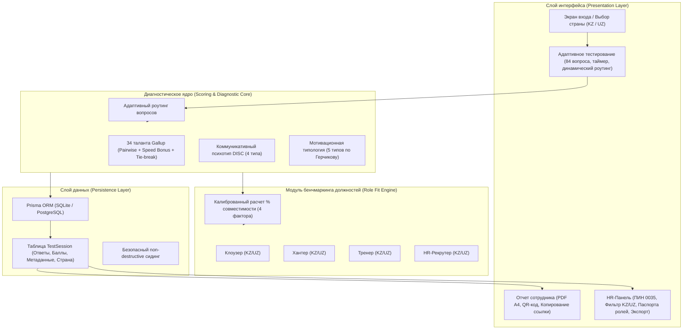

# Архитектура и системная логика Gallup 35 Health Clubs

> **Цель документа:** Систематизировать архитектуру проекта, выявить и устранить математические перекосы скоринга (причину заниженных процентов совпадения ролей), стандартизировать структуры данных и утвердить логику перед реализацией.

---

## 1. Разбор проблемы: Почему система «грубо оценивала в %»

При детальном аудите кода расчета совместимости (`calculateRoleMatch`) были выявлены **3 критические причины**, из-за которых даже идеальные кандидаты получали **35–48%** и клеймо *«Слабое соответствие (C)»*:

### Причина 1: Рассинхронизация ID талантов (Критический баг)
В базе данных (`TALENTS_DATA`) и эталонах должностей (`ROLE_BENCHMARKS`) номера талантов не совпадали:
- **Катализатор (Activator):** в базе имеет `id: 10`, а в эталонах искался `id: 12` (который в базе является *Общительностью*).
- **Командование (Command):** в базе имеет `id: 11`, а искался `id: 13` (который в базе *Конкуренция*).
- **Обаяние (Woo):** в базе `id: 17`, а искался `id: 18`.
- **Индивидуализация:** в базе `id: 24`, а искался `id: 21` (*Эмпатия*).
- **Ответственность:** в базе `id: 8`, а искался `id: 7` (*Фокус*).
- **Аналитик:** в базе `id: 27`, а искался `id: 31` (*Любознательность*).

**Следствие:** Алгоритм никогда не находил ключевые таланты в Топ-5 кандидата. Баллы за таланты обнулялись практически до нуля даже у образцовых сотрудников.

### Причина 2: Математическая ошибка в расчете доменов
В формуле доменов использовалась формула:
$$\text{domainPoints} += (\text{domScore} / 100) \times 15$$
Однако сумма всех 4 доменов Gallup у человека всегда равна **100%**. Средний показатель домена составляет 25%, а ярко выраженный доминирующий домен — **30–40%**. 
Формула же ожидала, что один домен может достигать 100%! В итоге даже кандидат с абсолютным доминированием целевого домена (35%) получал всего **5 баллов из 15** (эффективность лишь 33%).

### Причина 3: Токсичные вердикты низких грейдов
При результате ниже 55% система выводила демотивирующий текст:
> *«Слабое соответствие (C). На этой позиции сотруднику придется бороться со своей природой, что приведет к быстрому выгоранию.»*

В HR-практике Gallup оценка никогда не должна демотивировать человека: профиль сотрудника показывает его уникальные сильные стороны, которые просто эффективнее раскрываются в другой роли (например, не в «холодном дожиме», а в заботливом ведении тренировок или первичном приеме).

---

## 2. Новая архитектура системы

---

## 3. Математическая модель калиброванного скоринга (Role Match 0–100%)

Совместимость с должностью рассчитывается как взвешенная сумма **4 объективных факторов** (максимум 100%):

$$\text{Total Score} = \text{TalentPoints (до 45%)} + \text{DomainPoints (до 30%)} + \text{MotivationPoints (до 15%)} + \text{PsychotypePoints (до 10%)}$$

### Фактор 1: Целевые таланты (Вес: 45%)
В CliftonStrengths у каждого человека всего 5 доминирующих талантов из 34. Наличие **2–3 целевых талантов роли в Топ-10** — это выдающийся показатель (топ 2-5% популяции).

*Начисление баллов за каждый целевой талант:*
- Талант в **Топ-5**: **+15 баллов** (ключевая суперсила)
- Талант в **Топ-6..10**: **+10 баллов** (сильный поддерживающий талант)
- Талант в **Топ-11..15**: **+6 баллов** (активный вспомогательный ресурс)
- Талант в **Топ-16..20**: **+3 балла** (доступен при необходимости)

*Нормализация:* реалистичный целевой максимум составляет 42–45 баллов.
$$\text{TalentRatio} = \min\left(1, \frac{\sum \text{TalentPoints}}{45}\right) \times 45$$

*Защита:* Поиск таланта ведется одновременно по `id`, по `slug` и по нормализованному русскому названию, исключая любые сбои нумерации.

---

### Фактор 2: Доменное соответствие (Вес: 30%)
Оценивается не абстрактный процент, а распределение энергии кандидата:
1. **Совпадение доминирующего домена:** если ведущий домен кандидата совпадает с критическим доменом должности (например, «Влияние» для Клоузера или «Отношения» для Тренера) $\to$ **100% базы критического домена**.
2. **Концентрация Топ-5:** доля талантов из Топ-5 кандидата, попадающих в целевые домены должности (например, 3 из 5 или 4 из 5).
3. **Суммарный вес целевых доменов** в профиле кандидата.

$$\text{DomainRatio} = \min\left(1.0, \frac{\text{Доля целевых доменов}}{55\%} \times 0.5 + \frac{\text{Топ-5 в доменах}}{5} \times 0.3 + (\text{Ведущий совпал ? } 0.2 : 0.05)\right) \times 30$$

---

### Фактор 3: Мотивационный вектор (Вес: 15%)
Сопоставление типа мотивации кандидата с картой должности:
- Совпадение с **Первичным мотиватором** (например, «Денежник» для Клоузера): **15 баллов**
- Совпадение со **Вторичным мотиватором** (например, «Результатник»): **12 баллов**
- Вторичный мотив кандидата совпадает с первичным роли: **11 баллов**
- Вторичный мотив кандидата совпадает со вторичным роли: **9 баллов**
- Базовый уровень трудовой мотивации: **7 баллов**

---

### Фактор 4: Коммуникативный психотип DISC (Вес: 10%)
- Первичный психотип совпадает с целевым: **10 баллов**
- Вторичный психотип кандидата совпадает с целевым: **8 баллов**
- Смежный совместимый стиль коммуникации: **7 баллов**
- Базовый уровень адаптивности: **5 баллов**

---

## 4. Обновленная шкала грейдов и развивающие формулировки

Вместо карательных и демотивирующих вердиктов внедряется профессиональная матрица управленческих рекомендаций:

| Диапазон % | Грейд | Название | Цвет | Управленческий вердикт |
| :--- | :--- | :--- | :--- | :--- |
| **85% – 98%** | `ideal` | **Идеальное попадание (A+)** | Изумрудный (Emerald) | *«Прирожденный специалист в роли! Природные таланты и психотип на 100% соответствуют эталону 35 Health Clubs. Максимальная отдача и легкий ввод в должность.»* |
| **72% – 84%** | `recommended` | **Высокая совместимость (A)** | Бирюзовый (Teal) | *«Рекомендуется на должность. Сильный природный фундамент; после быстрой адаптации и изучения стандартов выйдет на плановые KPI.»* |
| **60% – 71%** | `conditional` | **Хороший потенциал (B)** | Янтарный (Amber) | *«Хороший потенциал. Сильные стороны частично перекрывают задачи роли; рекомендуется наставничество и фокус на регламентах.»* |
| **< 60%** | `low` | **Альтернативный профиль (C)** | Нейтральный сланец (Slate) | *«Профиль сотрудника больше ориентирован на другие векторы компании. Рекомендуется обратить внимание на роль [Название роли], где его суперсилы принесут максимальный результат.»* |

---

## 5. Эталоны 4 ключевых должностей 35 Health Clubs

### 1. Клоузер (Менеджер закрытия сделок)
- **Целевые таланты:** Достижение (1), Конкуренция (13), Распорядитель/Командование (11), Катализатор (10), Общительность (12), Организатор (2).
- **Критический домен:** Влияние (Influencing) + Исполнение (Executing).
- **Мотивация:** Денежник 💰 / Результатник 🏆.
- **Психотип:** Директив 🔴 / Экспрессив 🟡.

### 2. Хантер (Первичный контакт и лидогенерация)
- **Целевые таланты:** Обаяние/Woo (17), Позитивность (25), Катализатор (10), Индивидуализация (24), Эмпатия (21), Ответственность (8).
- **Критический домен:** Построение отношений (Relationship) + Влияние (Influencing).
- **Мотивация:** Результатник 🏆 / Денежник 💰.
- **Психотип:** Экспрессив 🟡 / Дружелюбный 🟢.

### 3. Тренер 35 Health Clubs
- **Целевые таланты:** Развитие (20), Эмпатия (21), Ответственность (8), Позитивность (25), Дисциплина (6), Восстановление (9).
- **Критический домен:** Построение отношений (Relationship) + Исполнение (Executing).
- **Мотивация:** Романтик/Призвание 🎨 / Результатник 🏆.
- **Психотип:** Дружелюбный 🟢 / Экспрессив 🟡.

### 4. HR-Рекрутер (Массовый подбор)
- **Целевые таланты:** Достижение (1), Организатор (2), Аналитик (27), Катализатор (10), Индивидуализация (24), Ответственность (8).
- **Критический домен:** Исполнение (Executing) + Стратегическое мышление (Strategic).
- **Мотивация:** Результатник 🏆 / Денежник 💰.
- **Психотип:** Директив 🔴 / Аналитик 🔵.
